<samp>RECIFE, BRASIL · DESIGN & CÓDIGO</samp>
<h1>Oi, eu sou o Christian.</h1>
<h3>Product Designer que implementa.</h3>

Christian Barnard · Aberto a oportunidades júnior em Product Design.

  
  
  

---

<h3>Entre o Figma e o código</h3>

<samp>DESIGN</samp>

  

Pesquisa UX · Design systems · Acessibilidade

<samp>DESENVOLVIMENTO</samp>

  

<h3>Projetos para explorar</h3>

- **[Void ↗](https://www.christianbj.com.br/void)** — App desktop de comunicação para equipes, com canais e voz, em beta.
- **[Covil dos Répteis ↗](https://www.christianbj.com.br/covil)** — Plataforma educativa para um santuário, com enciclopédia, perfis dos animais e gestão de conteúdo.
- **[Modale ↗](https://www.christianbj.com.br/modale)** — Pesquisa sobre transporte público no Recife traduzida em um protótipo com foco no passe.

---

<samp>POR AQUI, ATÉ AS CONTRIBUIÇÕES SE MEXEM.</samp>

<picture>
  <source media="(prefers-color-scheme: dark)" srcset="https://raw.githubusercontent.com/ChrisDevDesign/ChrisDevDesign/output/github-contribution-grid-snake-dark.svg?v=6" />
  <source media="(prefers-color-scheme: light)" srcset="https://raw.githubusercontent.com/ChrisDevDesign/ChrisDevDesign/output/github-contribution-grid-snake.svg?v=6" />
  
</picture>
